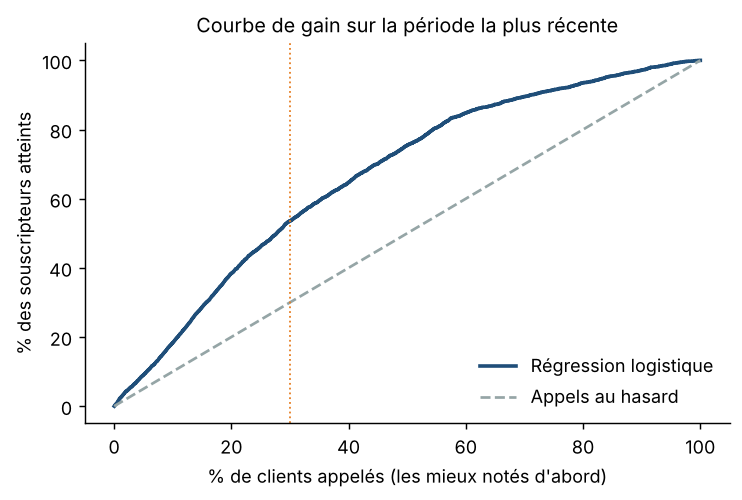
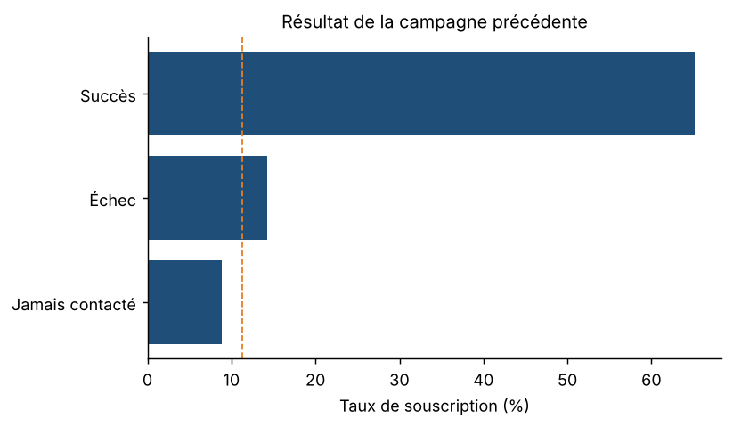
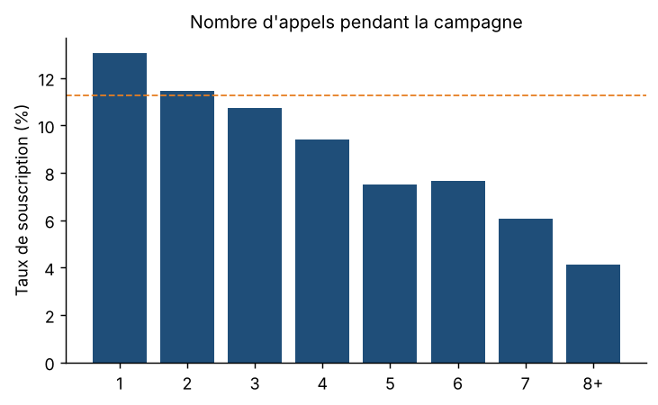

# 📞 Bank Marketing Analytics – qui appeler en priorité ?

[](https://github.com/MERVEILLEKAMDEM/bank-marketing-analytics/actions)

**Analyse de données réelles** : 41 188 appels de télémarketing d'une banque portugaise (2008-2010), qui proposait des dépôts à terme. Le but est de comprendre ce qui fait souscrire un client et de construire un modèle qui dit qui appeler en premier.

👉 **[Voir le tableau de bord en ligne](https://merveillekamdem.github.io/bank-marketing-analytics/)**



## Ce que disent les données

| Constat | Chiffre |
|---|---|
| Taux de souscription moyen | 11,3 % |
| Clients qui avaient souscrit lors de la campagne précédente | **65,1 %** de souscription |
| Effet de la relance excessive | 13,0 % au 1er appel, puis 4,1 % au-delà de 8 appels |
| Contexte de taux | souscription bien plus forte quand l'Euribor est bas |

## Modèle de ciblage

- **Pas de fuite de données** : la durée de l'appel est exclue, car elle n'est connue qu'une fois l'appel terminé (les auteurs du jeu de données le signalent).
- **Validation temporelle** : entraînement sur les 80 % d'appels les plus anciens, test sur les 20 % les plus récents. C'est la situation réelle d'une banque qui prépare sa prochaine campagne.

| Modèle | ROC AUC | PR AUC |
|---|---|---|
| **Régression logistique** | **0,741** | **0,521** |
| Gradient boosting | 0,639 | 0,432 |

**Résultat métier** : en appelant d'abord les 30 % de clients les mieux notés, on atteint **53,5 % des souscripteurs** (38,4 % avec 20 % des appels).

**Pourquoi la régression logistique gagne** : sur la période récente, le contexte économique sort des valeurs vues à l'entraînement (taux de souscription de 30,8 % contre 11,3 % en moyenne). Le gradient boosting, à base d'arbres, extrapole mal hors de ces valeurs. Le modèle linéaire, plus simple, se généralise mieux. Une validation aléatoire classique aurait masqué cet effet.

<p float="left">


</p>

## Lancer le projet

```bash
pip install -r requirements.txt
python src/analyse.py     # graphiques, tableau de bord docs/index.html, results/metrics.json
python -m pytest -q
```

## Source des données

UCI Machine Learning Repository, *Bank Marketing* (bank-additional-full). S. Moro, P. Cortez et P. Rita (2014), « A Data-Driven Approach to Predict the Success of Bank Telemarketing », *Decision Support Systems*. Licence CC BY 4.0.

---
Pascale KAMDEM · Data & IA · [LinkedIn](https://www.linkedin.com/in/merveille-kamdem-562aa0284/)
